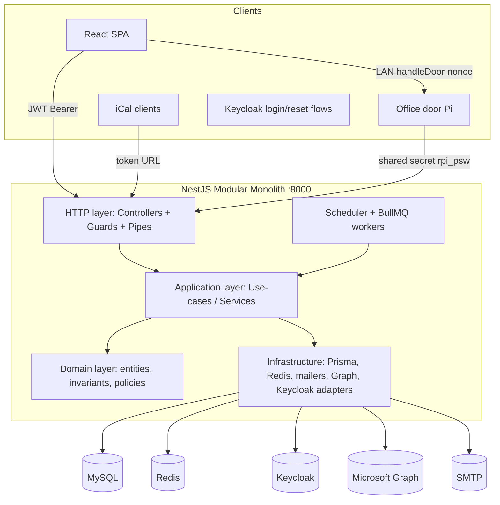
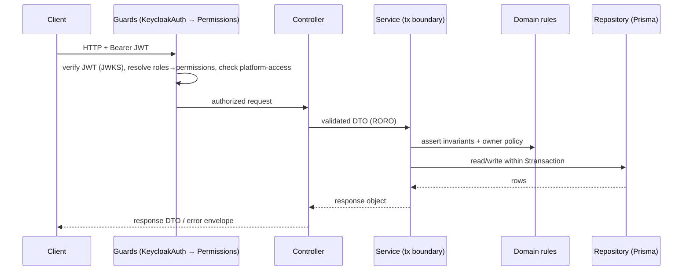

# Backend — Agent Guide (agora backend)

> Read root `AGENTS.md` first (shared TypeScript rules). This file covers backend-specific
> standards plus the architecture every backend issue needs regardless of domain. Situational
> architecture (auth internals, persistence, integrations, jobs, ops) lives in
> `docs/architecture/backend/` — your work item's plan will tell you which of those to read.
>
> Behavioral source of truth is the product spec (`docs/product-spec/`). Where this file and the spec
> disagree on *behavior*, the spec wins; on *structure/technology*, this file wins.

---

## Goals & Principles

1. **Spec-faithful.** Every endpoint, rule, and invariant traces back to a feature in the product spec.
2. **Security by default.** Every write is authorized **server-side**; UI checks are never the boundary.
3. **Modular monolith first.** One deployable, bounded domain modules with explicit boundaries —
  simple ops now, extractable into services later without rewrites.
4. **Functional & declarative.** Prefer pure functions, small composable providers, immutable data.
  Classes only where the framework requires them (modules, providers, guards, DTOs).
5. **RORO.** Services and use-cases **R**eceive an **O**bject and **R**eturn an **O**bject.
6. **Fail safe.** External-system outages fail closed with explicit errors.
7. **Auditable.** Append-only histories are never mutated in place by read paths.


## Technology Stack


| Concern          | Choice                                        | Notes                                                           |
| ---------------- | --------------------------------------------- | --------------------------------------------------------------- |
| Language         | **TypeScript** (strict)                       | `strict: true`, `noUncheckedIndexedAccess: true`.               |
| Framework        | **NestJS** (Express adapter)                  | Modular DI; HTTP listens on **:8000**.                          |
| Runtime          | **Node.js 22 LTS**                            | Pinned in `Dockerfile` + `.nvmrc`.                              |
| Package manager  | **pnpm**                                      | Lockfile committed.                                             |
| Database         | **MySQL 8.0**                                 | Legacy schema — see `docs/architecture/backend/persistence.md`. |
| ORM / migrations | **Prisma**                                    | Type-safe client + versioned migrations.                        |
| Validation       | **class-validator** + **class-transformer**   | On all DTOs via global `ValidationPipe`.                        |
| AuthN            | **Keycloak (OIDC)**                           | See `docs/architecture/backend/authentication.md`.              |
| AuthZ            | Custom two-layer mapping                      | See `docs/architecture/backend/authorization.md`.               |
| Background jobs  | **@nestjs/schedule** + **BullMQ** (Redis)     | See `docs/architecture/backend/background-jobs.md`.             |
| Logging          | **nestjs-pino**                               | Structured JSON logs, request-scoped correlation id.            |
| Observability    | **OpenTelemetry** + **Sentry**                | See `docs/architecture/backend/observability-security.md`.      |
| API docs         | **@nestjs/swagger**                           | OpenAPI from DTOs/decorators; Swagger UI local-only.            |
| Testing          | **Jest** + **Supertest** + **Testcontainers** | Unit, integration, e2e.                                         |
| Lint/format      | **ESLint** + **Prettier**                     | Enforced in CI.                                                 |


> If a library above is genuinely unsuitable for a task, deviate but document the reason in the PR.


## High-Level Architecture




**Layering rules (dependency direction points inward):**

- **HTTP layer** (`*.controller.ts`): translates HTTP ↔ DTOs, applies guards/pipes, never contains
business rules.
- **Application layer** (`*.service.ts` / use-cases): orchestrates domain logic and outbound calls,
owns transactions, returns plain objects. **Defines and owns the port interfaces** (e.g.
`MemberRepository`, `CalendarGateway`).
- **Domain layer**: pure functions and value objects encoding invariants. Depends on nothing — no
framework, I/O, or other layers.
- **Infrastructure layer**: adapters (e.g. `PrismaMemberRepository`, `GraphCalendarGateway`) that
**implement** the ports. The only layer allowed to import Prisma/Graph/Keycloak SDKs.

**Dependency rule (inward only, via Dependency Inversion).** Controllers depend on the application
layer; the application layer depends on the domain plus the ports it owns — never on infrastructure.
Infrastructure implements those ports. Concrete adapters bind to ports via Nest DI tokens (composition
root), staying swappable and mockable without the application referencing a concrete class.

## Project Structure

```
backend/
├─ prisma/
│  ├─ schema.prisma           # single source for DB schema
│  ├─ migrations/             # versioned, committed
│  └─ seed.ts                 # reference data (statuses, study courses, roles, event types)
├─ src/
│  ├─ main.ts                 # bootstrap, global pipes/filters, swagger
│  ├─ app.module.ts           # root module wiring
│  ├─ config/                 # typed config (env schema + ConfigModule)
│  ├─ common/                 # cross-cutting: guards, decorators, filters, interceptors, dto base
│  │  ├─ auth/                # KeycloakAuthGuard, PermissionsGuard, @RequirePermissions, @CurrentUser
│  │  ├─ errors/               # exception filter, domain error types
│  │  ├─ logging/               # pino setup, correlation-id middleware
│  │  ├─ pagination/           # cursor/offset helpers
│  │  └─ validation/           # shared validators (zip range, d.m.Y dates, etc.)
│  ├─ infrastructure/
│  │  ├─ prisma/               # PrismaService, transaction helper, soft-delete middleware
│  │  ├─ keycloak/             # admin client + token verification (JWKS)
│  │  ├─ graph/                # Microsoft Graph adapters
│  │  ├─ mail/                 # MailerService (SMTP + Graph), template renderer
│  │  ├─ cache/                # Redis module
│  │  └─ queue/                # BullMQ setup
│  └─ modules/                 # one folder per bounded context (see Module Catalogue below)
│     └─ <module>/
│        ├─ <module>.module.ts
│        ├─ <module>.controller.ts
│        ├─ <module>.service.ts
│        ├─ dto/               # request/response DTOs
│        ├─ domain/            # pure rules for this context
│        └─ <module>.repository.ts
└─ test/                       # e2e specs
```

**Conventions:** directories `lowercase-with-dashes`; files `kebab-case.role.ts`
(`registration.service.ts`, `participation.policy.ts`). One module = one bounded context.

**Module boundaries:**

- Organize by **domain module**, not by technical type at the root. Avoid a flat `src/controllers/`,
`src/services/`, `src/repositories/` layout.
- A module **exports services** (and optionally facades); do **not** export repositories, Prisma
types, or internal helpers unless there is a documented exception.
- **No circular module dependencies.** Extract shared logic to `common/` or a smaller shared module.
- Prefer concrete service names (`RegistrationApprovalService`) over dumping grounds
(`HelperService`, `CommonService`, `UtilsService`).

**Within a module**, optional internal layout: `<module>.module.ts`, `<module>.controller.ts`
(presentation), `<module>.service.ts` (application), `domain/` (pure rules), `dto/`,
`<module>.repository.ts` (infrastructure adapter, or `infrastructure/` if large).

## Module Catalogue

Modules map directly to product-spec domains. Each owns its tables, DTOs, rules; cross-module access
goes through the other module's **service**, never its repository or tables.


| Module          | Spec domain / features                                           | Owns (tables)                                                                               |
| --------------- | ---------------------------------------------------------------- | ------------------------------------------------------------------------------------------- |
| `auth`          | Actors & Permissions — login eligibility; `auth.login`           | session context, permission resolution (no user table)                                      |
| `members`       | Member profile, status, history, deletion, stats, exports        | `users`, `user_profiles`, `users_status*`, `study_courses`                                  |
| `registration`  | Public registration, signing, approval pipeline, survey          | `registration_requests`, `registration_surveys`                                             |
| `development`   | Career path, foundation module, skills                           | `laufbahn`, `basis_modul`, `skills*`, `roles`, projects, trainings                          |
| `events`        | Events, types, templates, participation, attendance, calendars   | `activities`, `activity_types`, `activity_user`                                             |
| `acquisition`   | Acquisition standing, overview, statistics, reminders            | derived from `activity_user` + status history                                               |
| `office`        | Door access, office-user access requests, device endpoints, logs | `office_log`, `office_door_activity_log`, `office_pi_online_logs`, `office_access_requests` |
| `provisioning`  | ERP & lock-system user provisioning, identity/group admin        | projections over Keycloak groups                                                            |
| `communication` | Email templates, feedback, transactional mail                    | `mails`                                                                                     |
| `integrations`  | Graph calendar/room/Teams OAuth + app-only provisioning adapters | none (infra-backed)                                                                         |
| `scheduler`     | Scheduled background tasks                                       | none (orchestrates other modules)                                                           |
| `observability` | `admin.observability`                                            | Sentry errors + swappable `UsageCollector` (Sentry Logs sink; no in-app dashboard)          |


## API Conventions

- **Style:** RESTful, resource-oriented, JSON. Base path `/api/v1`. Version via URL prefix.
- **RORO:** request body = a DTO object; responses = typed response DTOs (never leak Prisma models).
- **Naming:** plural nouns (`/events`, `/members/:id/skills`); non-CRUD actions use a sub-resource
verb (`POST /registrations/:id/board-approval`).
- **Validation:** global `ValidationPipe({ whitelist: true, forbidNonWhitelisted: true, transform: true })`. Reject unknown fields. Domain field rules live in `common/validation` and must match the
product spec — do not redefine them here.
- **Errors:** consistent envelope `{ error: { code, message, details? } }` via a global
`AllExceptionsFilter`. Stable machine-readable `code` values (`USER_NOT_FOUND`,
`CAPACITY_EXCEEDED`, `INVALID_STATE_TRANSITION`). Map domain errors → HTTP: not-found `404`,
forbidden `403`, conflict/invariant `409`, validation `422`, external outage `503`. Never leak
stack traces or secrets.
- **Pagination:** list endpoints paginate (cursor preferred for large/append-only sets; offset OK for
small admin lists). Always cap page size.
- **Idempotency:** state-transition endpoints must be safe to retry — re-check preconditions, treat
already-applied transitions as no-ops.
- **Time:** store UTC; business-rule comparisons use Europe/Berlin where spec-sensitive. Centralize
in a `clock` provider (mockable in tests).
- **OpenAPI:** every endpoint annotated; Swagger UI at `/api/docs` only when `NODE_ENV=local`.


## When adding an endpoint

Ship with DTOs, `@RequirePermissions`, owner-policy check (if owner-scoped), OpenAPI annotation, and
tests. Automatable gate: `node scripts/validate.mjs --base dev` (see `docs/validate.md`). Reviewer
judgment: `docs/architecture/backend/review-heuristics.md`. If the endpoint touches permissions or
ownership beyond a straightforward `@RequirePermissions`, read
`docs/architecture/backend/authorization.md`.

## Backend coding standards

- **File size:** hard limit **500 lines** under `src/` and `test/`. Split by concern approaching
~250 lines (`*.reads.ts`, `*.writes.ts`, `*.policy.ts`, dedicated test helpers).
- **Configuration:** no `process.env` access outside `src/config/`. Typed config only.
- **Naming:** concrete service names, not dumping grounds (`HelperService`, `CommonService`).
- **Layering (style enforcement):** pure domain functions are framework-free and unit-tested in
isolation. DTOs are the only shape crossing the HTTP boundary. Validate at boundaries (DTOs/pipes)
**and** in domain code where rules are non-trivial.


## Testing Strategy

- **Unit:** pure domain rules (capacity, status history, acquisition expiry, attendance window) —
fast, no I/O, clock injected.
- **Integration:** services + repositories against real MySQL/Redis via **Testcontainers**; verify
transactions and concurrency where relevant.
- **e2e:** HTTP through guards with mocked Keycloak/Graph; assert **authorization** per endpoint,
including negative cases (IDOR attempts, wrong role, expired token, IdP outage → 503).
- **Authorization snapshot test:** generate the endpoint→permission table and snapshot it so any
access-control change is visible in review.
- Coverage gates in CI; security-relevant paths (auth, provisioning, office, deletion) require
explicit negative tests.


## Appendix A — Request Lifecycle




## Appendix B — Permission Naming

`"<resource>:<action>"`, actions ⊆ `{read, write, create, update, delete, manage}`; `*` = area
override. Examples: `member:read`, `member.status:write`, `event:create`, `event:*`,
`attendance:read`, `office.door:control`, `skill.catalog:manage`, `system.settings:write`.
Super-Admin holds the implicit global `*:*`.

---


## Situational architecture (read only when your work item tags it)

- `docs/architecture/backend/authentication.md` — Keycloak JWT validation, JIT user creation,
office Pi / feedback-link / iCal non-Keycloak auth patterns
- `docs/architecture/backend/authorization.md` — two-layer role→permission mapping internals
- `docs/architecture/backend/persistence.md` — legacy-schema rules, migrations, repository rules,
expand/migrate/contract
- `docs/architecture/backend/external-integration.md` — Keycloak Admin, Microsoft Graph, Mail
- `docs/architecture/backend/background-jobs.md` — scheduler + BullMQ
- `docs/architecture/backend/observability-security.md` — logging, Sentry, security baseline
- `docs/architecture/backend/configuration-runtime.md` — env, containers, CI
- `docs/architecture/backend/scalability.md` — caching, stateless app, heavy aggregations
- `docs/architecture/backend/review-heuristics.md` — reviewer subagent only (not an implementer tag)

