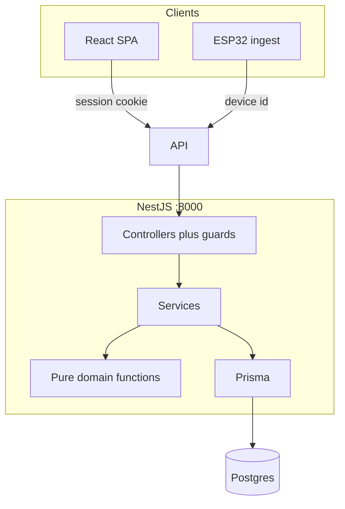

# Backend — Agent Guide

> Read root `AGENTS.md` first (shared TypeScript rules). This file covers backend-specific
> standards. System behavior lives in [`docs/architecture.md`](../docs/architecture.md). Where this
> file and that doc disagree on behavior, the architecture doc wins; on structure and technology,
> this file wins.

---

## Goals & Principles

1. **Server is authoritative** for power, cadence, distance, segment time, and who can see health data.
2. **Security by default.** Every user route checks the session. Riders read and write only their own
   bikes, plans, workouts, and heart rate. Device ingest can append samples and cannot read them.
3. **Modular monolith.** One deployable NestJS process, one module per bounded context.
4. **Functional where it counts.** Power, cadence, zone bounds, and coast-down fitting are pure
   functions. Classes only where Nest requires them (modules, providers, guards, DTOs).
5. **RORO.** Services receive an object and return an object.
6. **Fail closed.** Missing `ADMIN_PASSWORD` on an empty database prevents boot. Unknown devices
   are rejected.

## Technology Stack

| Concern | Choice | Notes |
| --- | --- | --- |
| Language | **TypeScript** (strict) | `strict: true`. |
| Framework | **NestJS** | HTTP on **:8000**. |
| Runtime | **Node.js 22** | Pinned in `Dockerfile` and `.nvmrc`. |
| Package manager | **pnpm** | Lockfile committed. |
| Database | **PostgreSQL** | Prisma migrations. |
| Validation | **class-validator** + **class-transformer** | Global `ValidationPipe`. |
| AuthN | **Session cookie** | argon2id password hashes. Random session id, hashed at rest. |
| Logging | **nestjs-pino** | Structured JSON. Never log passwords or session tokens. |
| API docs | **@nestjs/swagger** | Swagger UI when `NODE_ENV=local`. |
| Testing | **Jest** | Unit tests for pure derivation and coast-down. |
| Lint/format | **ESLint** + **Prettier** | |

## High-Level Architecture



**Layering:**

- **HTTP** (`*.controller.ts`): HTTP ↔ DTOs, guards, no business rules.
- **Application** (`*.service.ts`): transactions, orchestration, returns plain objects.
- **Domain** (`domain/`): pure functions. No Nest, Prisma, or I/O.
- **Infrastructure**: `PrismaService` only. Modules call Prisma through their own repository or
  service, not through another module's repository.

**Dependency rule.** Controllers depend on services. Services may call another module's exported
service. Domain imports nothing from Nest or Prisma.

## Project Structure

```
backend/
├─ prisma/
│  ├─ schema.prisma
│  ├─ migrations/
│  └─ seed.ts
├─ src/
│  ├─ main.ts
│  ├─ app.module.ts
│  ├─ config/
│  ├─ common/
│  │  ├─ auth/
│  │  ├─ errors/
│  │  └─ logging/
│  ├─ infrastructure/prisma/
│  └─ modules/
│     └─ <module>/
│        ├─ <module>.module.ts
│        ├─ <module>.controller.ts
│        ├─ <module>.service.ts
│        ├─ dto/
│        └─ domain/
└─ test/
```

**Conventions:** directories `lowercase-with-dashes`; files `kebab-case.role.ts`. One module = one
bounded context. Do not export another module's Prisma models from a controller.

## Module Catalogue

| Module | Owns |
| --- | --- |
| `auth` | Login, logout, session cookie, current user |
| `users` | Admin create and delete riders, profile FTP and HR zones, dummy-plan copy |
| `bikes` | Per-user wheel and gears |
| `trainers` | Household trainers, resistance levels, device id, power scale |
| `telemetry` | Device socket, clock offset, live snapshot, derivation |
| `workouts` | Free, planned, and zone-test rides; 1 Hz samples; segment clock |
| `plans` | Read-only plans and sessions |
| `zone-tests` | Ramp protocol and result history |
| `calibration` | Coast-down capture, fit, active curve |

Cross-module access goes through the other module's service.

## API Conventions

- REST, JSON, base path `/api/v1`.
- Responses are DTOs or plain objects, never raw Prisma graphs with password hashes.
- Global `ValidationPipe({ whitelist: true, forbidNonWhitelisted: true, transform: true })`.
- Errors: `{ error: { code, message } }`. Codes are stable (`USER_NOT_FOUND`, `INVALID_CREDENTIALS`,
  `FORBIDDEN`). 404 not found, 403 forbidden, 409 conflict, 422 validation, 401 unauthenticated.
- Store UTC.
- Swagger at `/api/docs` only when `NODE_ENV=local`.

## When adding an endpoint

Ship a DTO, the session guard (or the device-id check for ingest), and a service method that scopes
health data to `currentUser.id`. Admin-only routes check `role === 'admin'`.

## Backend coding standards

- **File size:** hard limit **500 lines** under `src/` and `test/`.
- **Configuration:** no `process.env` access outside `src/config/`.
- **Naming:** concrete service names, not `HelperService`.
- Pure domain functions are framework-free and unit-tested.

## Testing Strategy

- **Unit:** cadence, speed, power interpolation, zone bounds, coast-down fit, ramp FTP estimate.
- **Service tests** where auth scoping is easy to get wrong (rider cannot read another rider's workout).

## Request lifecycle

Session cookie → guard loads the user → controller → service → domain → Prisma. Device ingest skips
the user guard, checks the device id, and appends samples onto the active workout for that trainer
using the rider setup that workout snapshotted.
