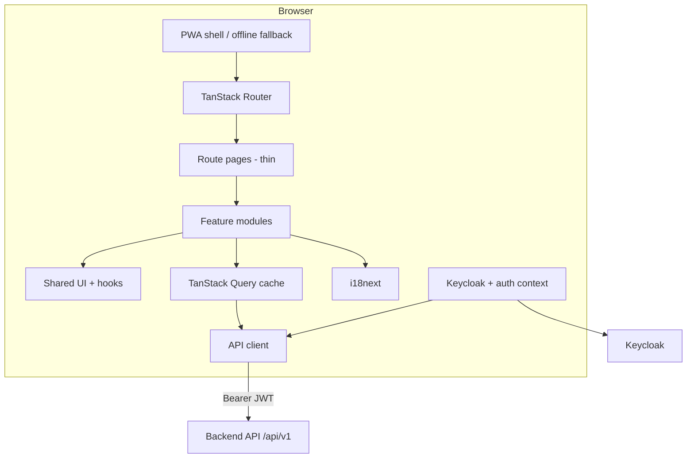
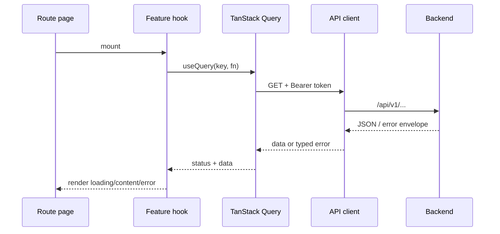

# Frontend — Agent Guide (agora frontend)

> Read root `AGENTS.md` first (shared TypeScript rules). This file covers frontend-specific
> standards plus the architecture every frontend issue needs regardless of domain. Situational
> architecture lives in `docs/architecture/frontend/` — your work item's plan will tell you which
> of those to read. Visual defaults (required before new/changed UI screens):
> [`docs/ui/style-guide.md`](../docs/ui/style-guide.md).
>
> Behavioral source of truth is the product spec (`docs/product-spec/`). Where this file and the spec
> disagree on *behavior*, the spec wins; on *structure/technology*, this file wins.

---

## Goals & Principles

1. **Spec-faithful.** Every screen, flow, and label traces back to a feature in the product spec.
2. **Backend is authoritative.** The API enforces permissions and business rules. UI checks improve
  UX only — never replace server enforcement.
3. **Feature-first structure.** Code organized by product domain, not technical type at the root.
4. **Functional components.** React function components with hooks; no class components.
5. **Minimal client state.** Server state via TanStack Query; local UI state stays small, colocated.
6. **Accessible, responsive & mobile-capable.** Mobile support is non-negotiable. Every screen must
  work on phone-sized viewports (minimum 320 px). Design mobile-first and verify at 375 px before
  considering UI work complete. Keyboard and screen-reader support for core flows.
7. **English code, localized UI.** All identifiers, comments, route paths, translation keys are
  **English**. User-visible text exists only in i18n resource files.


## Technology Stack


| Concern         | Choice                                            | Notes                                                       |
| --------------- | ------------------------------------------------- | ----------------------------------------------------------- |
| Language        | **TypeScript** (strict)                           | `strict: true`, `noUncheckedIndexedAccess: true`.           |
| Framework       | **React 19**                                      | Function components only.                                   |
| Build           | **Vite**                                          | Dev server + production bundle.                             |
| Package manager | **pnpm**                                          | Lockfile committed.                                         |
| Routing         | **TanStack Router**                               | See `docs/architecture/frontend/routing.md`.                |
| Server state    | **TanStack Query**                                | See `docs/architecture/frontend/data-fetching.md`.          |
| UI components   | **Chakra UI v3**                                  | Themed primitives, forms, overlays, layout.                 |
| Styling         | **Tailwind CSS**                                  | Layout/spacing utilities alongside Chakra.                  |
| Forms           | **react-hook-form** + **Zod**                     | See `docs/architecture/frontend/forms-validation.md`.       |
| Auth            | **Keycloak JS**                                   | See `docs/architecture/frontend/authentication.md`.         |
| HTTP            | **fetch** via typed API client                    | Thin wrapper; no axios unless justified.                    |
| Dates           | **date-fns** + **date-fns-tz**                    | Display/format in **Europe/Berlin**.                        |
| i18n            | **i18next** + **react-i18next**                   | Locales: `en`, `de`.                                        |
| PWA             | **vite-plugin-pwa**                               | Installable app + offline fallback page.                    |
| Errors / usage  | **Sentry** (+ optional analytics)                 | See `docs/architecture/frontend/observability.md`.          |
| Testing         | **Vitest** + **Testing Library** + **Playwright** | Unit/component; critical-path e2e.                          |
| Lint/format     | **ESLint** + **Prettier**                         | Consider `eslint-plugin-i18next` for literal-string checks. |


> If a library above is genuinely unsuitable for a task, deviate but document the reason in the PR.


## High-Level Architecture




**Layering rules (dependency direction points inward):**

- **Route pages** (`routes/*.tsx`): compose feature components, wire loaders/guards, no business logic.
- **Feature modules** (`features/<domain>/`): screens, feature components, hooks, queries, local types.
- **Shared** (`shared/`): design-system wrappers, generic hooks, utilities, API client, auth, layouts.
- **Domain helpers** (`features/<domain>/utils/` or `shared/domain/`): pure functions — no React imports.

**Dependency rule.** Routes depend on features; features depend on shared abstractions. Features do
**not** import from other features directly — share via `shared/` or explicit feature public APIs.

**Component hierarchy:** Route page (composition only) → Feature module (domain UI + hooks + queries)
→ Shared UI (generic components, no domain knowledge).

**Data flow (server state):** `shared/api/<domain>.ts` (pure async HTTP, no React) →
`features/<domain>/queries/` (query keys + useQuery/useMutation) → `features/<domain>/` (components
consume hooks only). Components import **hooks**, not API service functions directly. Auth token
injection happens inside `shared/api/client.ts`, not per-call in features.

## Project Structure

```
frontend/
├─ index.html
├─ public/                        # static assets, PWA icons, manifest fragments
├─ src/
│  ├─ main.tsx                    # bootstrap: providers, router, query client
│  ├─ routes/                     # TanStack Router tree (thin pages)
│  ├─ features/                   # one folder per product domain (see Feature Catalogue)
│  │  └─ <feature>/
│  │     ├─ index.ts               # public exports only
│  │     ├─ components/
│  │     ├─ hooks/
│  │     ├─ queries/               # query keys + useQuery/useMutation wrappers
│  │     ├─ types.ts               # feature-specific API/view types
│  │     └─ utils/                 # pure helpers
│  ├─ shared/
│  │  ├─ api/                     # client, error parsing, types aligned with OpenAPI
│  │  ├─ auth/                    # Keycloak provider, useAuth, usePermissions, route guards
│  │  ├─ ui/                      # Chakra theme, generic reusable components
│  │  ├─ layouts/                 # AppShell; nav-config.ts, filter-nav-by-permission.ts
│  │  ├─ i18n/                    # i18next setup, locale files, useTranslation helpers
│  │  ├─ routes.ts                # ROUTES constants — English path strings only
│  │  ├─ hooks/
│  │  └─ utils/                   # dates, formatting, getErrorMessage
│  ├─ config/                     # typed env (VITE_*), feature flags
│  └─ test/                       # test utils, MSW handlers
├─ e2e/                           # Playwright specs
├─ vite.config.ts
├─ tailwind.config.js
└─ Dockerfile / Dockerfile.dev
```

**Conventions:** directories `lowercase-with-dashes`; components `PascalCase.tsx`; hooks `use-*.ts`;
queries `*.queries.ts`; avoid root-level `components/`, `pages/`, `hooks/` buckets.

**Feature boundaries:** export hooks/components intended for other features via `index.ts`; keep
internals private. **No circular feature imports** — shared logic goes to `shared/`. Prefer concrete
names (`useEventSignup`, `MemberProfileForm`) over `HelperModal`, `CommonForm`.

**Rules per layer:**

- `shared/api/` — pure async functions; no React/hooks/JSX. One file per backend domain. All
requests go through `createClient()`; errors parsed to typed `ApiError`. Import nothing from `features/`.
- `shared/ui/` — generic, reusable, no domain knowledge. Accept data via props.
- `features/<domain>/` — domain screens, hooks, queries, types. May import `shared/*`. **Must not
import another feature module** — compose cross-domain UI at the route page level.
- `routes/` — thin route entries. Wire loaders/guards and compose features; no inline
`.map`/`.filter`/`.reduce` over fetched data.
- `shared/layouts/` — app shell, nav skeleton. `nav-config.ts` lists routes, i18n label keys
(not literal strings), icons, permission keys; `filter-nav-by-permission.ts` is a pure filter.


## Feature Catalogue

Features map to product-spec domains. Each owns its routes, queries, and UI.


| Feature         | Feature ID(s)                                              | Spec domain                                            | Route access                              |
| --------------- | ---------------------------------------------------------- | ------------------------------------------------------ | ----------------------------------------- |
| `auth`          | `auth.login`, `platform.auth-bootstrap`                    | `auth.login`                                           | Login redirect, logout, session bootstrap |
| `registration`  | `registration.signing`, `registration.validation`          | Public registration & signing                          | **Public** (+ token-based signing)        |
| `dashboard`     | `dashboard.home`                                           | Home dashboard                                         | Authenticated                             |
| `members`       | `members.profile`, `members.statistics`, `members.exports`, `members.alumni-application` | Profiles, directory, stats, exports, standalone alumni application | Authenticated                             |
| `member-admin`  | `members.status`, `members.deletion`, `members.renewal`    | Status, deletion, renewal, management                  | Privileged                                |
| `development`   | `development.career-path`, `development.skills`            | Career, foundation module, skills                      | Authenticated / privileged                |
| `events`        | `events.*`                                                 | Events, participation, attendance, calendars           | Authenticated                             |
| `acquisition`   | `acquisition.*`                                            | Personal & org-wide standing                           | Authenticated / privileged                |
| `office`        | `office.*`                                                 | Door access, status, admin logs                        | Authenticated / privileged                |
| `admin`         | `admin.*`                                                  | Registration pipeline, templates, survey, provisioning | Privileged                                |
| `communication` | `communication.*`                                          | Feedback, templates (where UI exists)                  | Public / authenticated                    |
| `settings`      | `events.calendar-invitations`                              | Calendar invitation opt-in, preferences                | Authenticated                             |
| `privacy`       | `privacy.page`                                             | Privacy policy                                         | **Public**                                |
| `pwa`           | `pwa.install`                                              | Installable app & offline                              | Global shell                              |
| `platform`      | `platform.app-shell`, `platform.infra`, `dev.db-stats`     | — (infra)                                              | Shell / dev                               |


## Internationalization — enforceable rules

Full i18n system design (namespace structure, language switcher): `docs/architecture/frontend/internationalization.md`.

- **Zero user-visible literals** in TS/TSX — no German or English copy in components, hooks, Zod
schemas, nav config, toasts, or `aria-*`. All copy via `t()` / `<Trans>`.
- Translation **keys are English dot paths** (e.g. `events:list.upcoming`); never German words as keys.
- Every new/changed key exists in **both** `en` and `de` in the same PR.
- Never commit UI strings outside `shared/i18n/locales/`.
- Include **all** user-visible strings: labels, placeholders, `aria-label`, tooltips, validation
messages, empty/error/loading states, dialog copy, toast text, page titles.
- What stays out of i18n: code identifiers, file names, routes, permission strings, API field names,
env vars, logs, and backend-provided user-generated content (member names, event titles).


## Frontend coding standards


| File type           | Soft limit | Hard limit |
| ------------------- | ---------- | ---------- |
| Route page          | 150        | 250        |
| Feature component   | 200        | 400        |
| Shared UI component | 120        | 200        |
| Custom hook         | 150        | 250        |
| API service file    | 100        | 200        |
| Query/mutation file | 100        | 150        |


No file exceeds **500 lines** under any circumstance. Split by concern before ~80% of a limit.
Enforced by `scripts/validate.mjs` on changed files (soft warning at ~80%, hard error at the limit) —
see [`docs/validate.md`](../docs/validate.md).

- **Configuration:** no `import.meta.env` access outside `src/config/`. Typed config only.
- **Components stay presentational** where possible; data fetching in hooks/queries, not leaf widgets.
Extract a custom hook when a component exceeds ~120 lines of JSX or has >3 related `useState` calls.
Hooks return a plain object; **zero JSX** in hooks. Co-locate with the feature.
- Colocate styles with components; extract only when reused.
- **No business rules duplicated** from the backend — display logic and formatting only; treat the
backend response as final when rules must be previewed client-side.
- **Naming:** event handlers `onVerbNoun` (e.g. `onSignupClick`); props `interface XProps` colocated.

**Prefer:**

- existing project patterns over new abstractions
- shared layout/state components over ad-hoc Box/Stack page structure
- real `<Link>` / `Button asChild` for cross-route navigation (Ctrl/Cmd+click); `useNavigate` only
  for post-mutation redirects, replace gates, query updates, and non-GET actions — see
  `docs/architecture/frontend/routing.md`
- small, focused changes over unnecessary refactors
- updating documentation when architecture or coding conventions change


## Testing Strategy

- **Unit:** pure utils (date formatting, display mappers, permission helpers).
- **Component:** Testing Library — wrap with `I18nextProvider`; assert visible text via keys or both
locales where behavior differs.
- **i18n:** new keys present in **both** `en` and `de`; optional script/CI check for missing keys.
- **Integration:** MSW-backed query hooks — loading/error/success paths.
- **e2e (Playwright):** happy paths for registration, login shell, event sign-up, profile edit; test
at least default locale (`de`); language switcher smoke test when touched.
- Permission-sensitive screens: assert controls hidden **and** API 403 handled if forced.


## Appendix A — Request Flow (authenticated page)




---


## Situational architecture (read only when your work item tags it)

- `docs/architecture/frontend/authentication.md` — Keycloak OIDC, token handling, bootstrap
- `docs/architecture/frontend/authorization.md` — UI gating (`usePermissions`, `RequirePermission`)
- `docs/architecture/frontend/internationalization.md` — namespace structure, language switcher
- `docs/architecture/frontend/routing.md` — route groups, `ROUTES` constants, public/special flows
- `docs/architecture/frontend/data-fetching.md` — API client, TanStack Query conventions
- `docs/architecture/frontend/forms-validation.md` — react-hook-form + Zod, dates, confirmations
- `docs/architecture/frontend/ui-accessibility.md` — Chakra theming, color mode, mobile/PWA/QR
- `docs/architecture/frontend/observability.md` — Sentry, usage events, error-code mapping
- `docs/architecture/frontend/configuration-runtime.md` — env vars, containers, CI
- `docs/architecture/frontend/performance.md` — lazy loading, caching, bundle hygiene
- `docs/architecture/frontend/review-heuristics.md` — reviewer subagent only (not an implementer tag)

**UI visual defaults** (not an Architecture-docs tag): [`docs/ui/style-guide.md`](../docs/ui/style-guide.md) —
required when changing routes or user-visible components; skip for pure API-client / query / util work.

