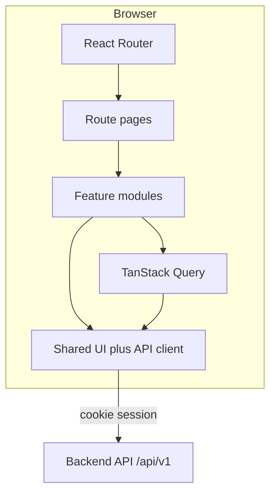

# Frontend — Agent Guide

> Read root `AGENTS.md` first (shared TypeScript rules). This file covers frontend-specific
> standards. System behavior lives in [`docs/architecture.md`](../docs/architecture.md). Where this
> file and that doc disagree on behavior, the architecture doc wins; on structure and technology,
> this file wins.

---

## Goals & Principles

1. **Backend is authoritative.** Recorded power, cadence, segment timing, and permissions come from
   the API. The UI displays them and sends intent (login, gears, resistance, start, stop).
2. **Feature-first structure.** Code organized by product domain, not technical type at the root.
3. **Functional components.** React function components with hooks; no class components.
4. **Minimal client state.** Server state via TanStack Query; local UI state stays small and colocated.
5. **Glanceable ride UI.** The ride screen is the center of the product. It is a fixed landscape
   laptop viewed from the bike: large type, high contrast, large controls. Phone layouts are not a
   goal.
6. **English.** Identifiers, comments, routes, and user-visible copy are English.

## Technology Stack

| Concern | Choice | Notes |
| --- | --- | --- |
| Language | **TypeScript** (strict) | `strict: true`. |
| Framework | **React 19** | Function components only. |
| Build | **Vite** | Dev server + production bundle. |
| Package manager | **pnpm** | Lockfile committed. |
| Routing | **React Router** | Thin route entries. |
| Server state | **TanStack Query** | Queries and mutations per feature. |
| Styling | **Tailwind CSS** | Ride screen is custom layout, not a component kit. |
| Forms | **react-hook-form** + **Zod** | Setup and login forms. |
| Auth | **httpOnly session cookie** | `credentials: 'include'`. Login is the only public screen. |
| HTTP | **fetch** via typed API client | Thin wrapper. |
| Live data | **WebSocket** | Ride snapshot. REST for everything else. |
| Dates | **date-fns** | Display in local time; store UTC on the server. |
| Testing | **Vitest** + **Testing Library** | Pure helpers and key components. |
| Lint/format | **ESLint** + **Prettier** | |

## High-Level Architecture



**Layering:**

- **Route pages** (`routes/*.tsx`): compose feature components. No business rules.
- **Feature modules** (`features/<domain>/`): screens, components, hooks, queries, local types.
- **Shared** (`shared/`): API client, generic UI, layouts, pure helpers.

**Dependency rule.** Routes depend on features. Features depend on shared. Features do not import
other features. Cross-feature screens are composed by the route.

**Data flow:** `shared/api/<domain>.ts` (pure async HTTP, no React) → `features/<domain>/queries/`
→ components consume hooks only. The session cookie is attached in `shared/api/client.ts`.

## Project Structure

```
frontend/
├─ index.html
├─ src/
│  ├─ main.tsx
│  ├─ routes/
│  ├─ features/
│  │  └─ <feature>/
│  │     ├─ components/
│  │     ├─ hooks/
│  │     ├─ queries/
│  │     ├─ types.ts
│  │     └─ utils/
│  ├─ shared/
│  │  ├─ api/
│  │  ├─ ui/
│  │  ├─ layouts/
│  │  └─ utils/
│  └─ test/
├─ vite.config.ts
└─ Dockerfile
```

**Conventions:** directories `lowercase-with-dashes`; components `PascalCase.tsx`; hooks `use-*.ts`;
queries `*.queries.ts`.

**Feature boundaries:** no circular feature imports. Share through `shared/`.

## Feature Catalogue

| Feature | What it owns | Access |
| --- | --- | --- |
| `auth` | Login, session bootstrap, logout | Public login only |
| `users` | Admin create and delete riders | Admin |
| `bikes` | Wheel size and gear teeth | Authenticated, own bikes |
| `trainers` | Household trainers, device id, resistance, calibration | Authenticated |
| `plans` | Dummy plan calendar | Authenticated, own plans |
| `ride` | Live zone screen, free ride and planned workout | Authenticated |
| `zone-tests` | Ramp test and result history | Authenticated, own results |

## Frontend coding standards

| File type | Soft limit | Hard limit |
| --- | --- | --- |
| Route page | 150 | 250 |
| Feature component | 200 | 400 |
| Shared UI component | 120 | 200 |
| Custom hook | 150 | 250 |
| API service file | 100 | 200 |
| Query file | 100 | 150 |

No file exceeds **500 lines**. Split before ~80% of a limit.

- **Configuration:** no `import.meta.env` access outside `src/config/`.
- **Components stay presentational** where possible. Data fetching lives in hooks and queries.
- Hooks return a plain object and contain no JSX.
- **No business rules duplicated** from the backend. Formatting and display only. Zone colors and
  the rail may mirror the server's zone table so the marker can move between snapshots; the server
  snapshot is the value that gets shown.
- **Naming:** event handlers `onVerbNoun`; props `interface XProps` colocated.

## Testing Strategy

- **Unit:** pure utils (zone position, formatting).
- **Component:** Testing Library for login and the zone rail.
- Critical ride behavior is covered by the zone-position helper plus a component render of the rail.
